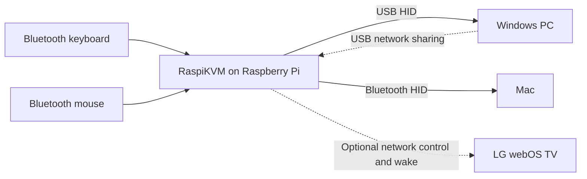

<p align="center">
  
</p>

# RaspiKVM

Share a Bluetooth keyboard and mouse between a USB-connected PC and a Bluetooth-connected Mac using a Raspberry Pi. Switch both devices with a keyboard shortcut, customize Logitech mouse buttons, and optionally make an LG webOS TV follow the selected computer.

RaspiKVM continues **RaspiKey**, created by **George Samartzidis**, extending the original keyboard adapter into a keyboard, mouse and monitor switching system.

## How it works

Pair the keyboard and mouse with the Pi. It presents standard HID input devices to the selected computer: over USB to the PC, or over Bluetooth to the other computer. No RaspiKVM input driver or Logitech Options installation is needed for the implemented mouse controls.



Only one computer receives input at a time. USB networking and the web UI remain accessible through the PC while input goes to the Mac. TV control changes its physical HDMI source; RaspiKVM does not capture or transmit video.

## What works today

- **Keyboard forwarding and keymaps.** Apple keyboard handling, media keys, configurable key swaps and custom JSON keymaps. Fn and Control can work as labeled.
- **Mouse forwarding.** Pointer movement, left/right/middle clicks, Back/Forward, the thumb/task-switch button and both wheels on the Logitech MX Master 3S.
- **Logitech controls.** Free-spin, ratchet and SmartShift modes, plus configurable shortcuts for supported mouse buttons. The scroll-mode button can send a screenshot shortcut while the web UI controls the wheel mode.
- **Host switching.** A configurable shortcut or web button switches both devices. The initial shortcut is **Ctrl+Alt+F12**. Optional scroll reversal gives the Bluetooth host a consistent wheel direction.
- **Mac sleep handling.** Reported HID suspend or disconnection returns input to USB. Explicitly selecting the Mac can request wake when a usable Bluetooth connection is available. Startup and ordinary PC input do not request Mac wake.
- **LG webOS TV control.** Direct local pairing, configurable HDMI sources, source switching with the KVM route, and Wake-on-LAN from keyboard or mouse activity. A separate worker keeps TV network operations out of the input-forwarding path.
- **Updates without reflashing.** SSH deployment, health checks, incremental native compilation and rollback. Routine application updates use SSH keys and a scoped password-free deployment helper.

## Tested setup and limits

Hardware validation used a **Pi Zero W 1.1**, **Raspberry Pi OS Lite 32-bit Trixie**, **Apple Wireless Keyboard A1314**, **Logitech MX Master 3S**, **Windows 11** and a **MacBook Air running macOS**. Direct source switching and wake were tested with an **LG 55NANO966PA**.

Other devices and operating systems may need additional work. Mac wake depends on its Bluetooth connection and sleep behavior. The TV integration currently targets LG webOS, not arbitrary monitor protocols.

The Pi reaches the network through **Windows USB Internet sharing**, so Pi Wi-Fi is optional for the tested setup. TV control depends on the shared connection remaining available. Wake was verified with both the TV's IP and its subnet broadcast address configured; whether the extra address is necessary has not been isolated.

The development OS is writable: shut it down before removing power. A read-only appliance image and complete generated SD-card image are not implemented yet.

## Get started

You need a Pi Zero W, an 8 GB or larger microSD card, a USB **data** cable connected to its USB port, and a Windows development PC with WSL Ubuntu. Use a separate test Pi if an existing adapter is your active keyboard connection.

```powershell
git clone --branch dev/modern-kvm https://github.com/pszeder/RaspiKVM.git
Set-Location RaspiKVM
```

Follow the [setup and deployment guide](docs/development.html) to flash stock Trixie Lite, enable USB networking and key-based SSH, perform the first installation, and create the ignored `.dev` target profile. The backend compiles on the Pi; the frontend builds in WSL. The first native build can take many minutes on a Zero W.

The guides include paths and addresses from the maintained test setup. Substitute your checkout path and verified target details. Setup no longer depends on the original prebuilt RaspiKey images or release downloads.

After initial setup:

```powershell
.\dev.ps1 doctor       # Check the configured Pi and services
.\dev.ps1 update       # Build and deploy an application update
.\dev.ps1 rollback     # Restore the previous application
.\dev.ps1 logs         # Read application logs
.\dev.ps1 ssh          # Open an SSH shell
.\dev.ps1 poweroff     # Shut down before unplugging
```

Open the Pi's web UI to pair devices and configure switching, mouse buttons and TV control. Pair the second computer with its advertised **RaspiKey KVM** device. Runtime names, `raspikey` directories, services and on-device paths are intentionally retained for now; **RaspiKVM** is the project and documentation name.

Routine updates preserve pairing and settings, but briefly interrupt forwarding while the application restarts. OS, USB gadget and privileged framework changes use the setup/maintenance workflow and may require a sudo password.

## Guides

| Topic | Guide |
| --- | --- |
| Initial setup, SSH, build, deploy and rollback | [Development](docs/development.html) |
| USB/Bluetooth switching and Mac sleep/wake | [KVM](docs/kvm.html) |
| Mouse pairing and baseline forwarding | [Mouse](docs/mouse.html) |
| Scroll modes and button shortcuts | [Mouse controls](docs/mouse-buttons.html) |
| Input tuning and measurement boundaries | [Performance](docs/input-performance.html) |
| Direct LG pairing, HDMI selection and wake | [TV control](docs/tv-control.html) |

Download or open the HTML guides locally in a browser. Checkpoint sections retain historical build identifiers and local recovery paths.

## Input performance

Native forwarding uses short HID reports, prioritized input threads and tuned USB polling. The MX Master 3S path requests a shorter Bluetooth LE connection interval when supported. TV control runs separately and receives activity intent, not typed characters or raw pointer reports.

The performance guide records **Pi-side processing and scheduling delays**, not physical key-to-screen or click-to-screen measurements. Keyboard scanning, Bluetooth transport, host input handling and display refresh also contribute to perceived lag. No end-to-end latency guarantee is claimed.

## Origin and attribution

**George Samartzidis** created RaspiKey at `samartzidis/RaspiKey`. **He has since deleted the original GitHub repository.** Its history survives through forks, which made this continuation possible. RaspiKVM is independently maintained by [Patrik Szeder](https://github.com/pszeder); it is not an official release from the original author.

The preserved original history ends at [`c85b8b1`](https://github.com/pszeder/RaspiKVM/commit/c85b8b12bb00fe585c4bd7fafe17f886033ced9f), dated 28 November 2022. George added the MIT license in [`b8a0f9a`](https://github.com/pszeder/RaspiKVM/commit/b8a0f9a28fbee39fe631dfad63b7c90868c353c5), dated 17 February 2021. This development branch is based on that history, including the original license commit.

Thanks also to the contributors who preserved the repository and the third-party projects used here, including BlueZ, Crow, nlohmann/json, Vue and websocket-client.

## License

The original **MIT license and copyright notice are preserved unchanged** in [LICENSE](LICENSE). Retain those notices when redistributing the covered code.

Third-party components retain their own terms. The bundled BlueZ `gdbus` sources are **GPL-2.0-or-later** and are compiled into the executable, so the complete binary should not be described as MIT-only. The TV worker's websocket-client dependency and Material Icons use Apache-2.0. Preserve applicable notices and satisfy dependency obligations when distributing source or binaries. See the source headers and [TV dependency notice](raspikey/tv/THIRD_PARTY.txt).

The new [RaspiKVM logo](images/raspikvm-logo.svg) uses original switch-symbol artwork and Roboto lettering; font attribution is recorded in [images/README.md](images/README.md).
